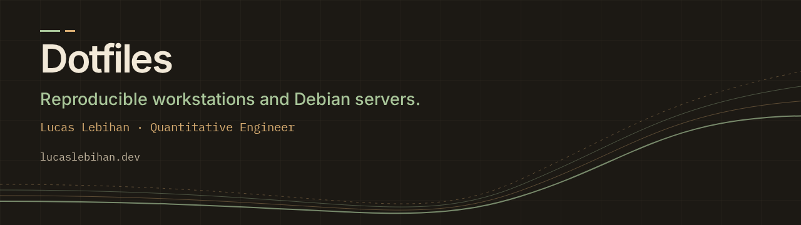

# Dotfiles



[](https://github.com/HtFilia/dotfiles/actions/workflows/ci.yml)
[](LICENSE)

Shell, Git, SSH, tmux, Kitty, Neovim and VS Code configuration for four
machines, managed with [chezmoi](https://www.chezmoi.io/). chezmoi deploys the
files, installs packages with each platform's package manager and downloads
the few pinned binaries a platform lacks.

| Machine | OS | Profile | Context | Package sources |
|---|---|---|---|---|
| Personal workstation (development, games) | Fedora 44+, KDE Plasma | `workstation` | `perso`, gaming | dnf, COPR, Microsoft (VS Code), pinned GitHub releases |
| Work workstation | Debian 13 | `workstation` | `travail` | Official apt repositories, pinned GitHub releases |
| VPS | Debian 13, no desktop | `server` | `perso` | Official apt repositories, pinned GitHub releases |
| Mac | macOS | `workstation` | `perso` | Homebrew |

## Install

Run the commands as your regular user. The package scripts print what they
install and say so before each command that uses sudo. A machine set up with
the former Bash scripts follows the [migration guide](docs/MIGRATION.md) once.

### Fedora

<!-- install:fedora -->
```sh
sudo dnf install -y chezmoi git
chezmoi init --apply HtFilia
```

### Debian 13 (work workstation and VPS)

chezmoi is not packaged in Debian 13. Download the pinned release, check it
against the published checksums and the hash pinned here, and install it in
`~/.local/bin`; chezmoi then manages its own binary.

<!-- install:debian -->
```sh
sudo apt-get update && sudo apt-get install -y ca-certificates curl git
cd "$(mktemp -d)"
version=2.73.3
archive="chezmoi_${version}_linux_amd64.tar.gz"
base="https://github.com/twpayne/chezmoi/releases/download/v${version}"
curl -fsSL -O "$base/$archive" -O "$base/chezmoi_${version}_checksums.txt"
sha256sum --check --ignore-missing "chezmoi_${version}_checksums.txt"
echo "6e5827598cbfc02d132b04f95b5ea10efb5b79230e2a4a0e52df4af144a8ee9f  $archive" | sha256sum --check
mkdir -p ~/.local/bin && tar -xzf "$archive" -C ~/.local/bin chezmoi
~/.local/bin/chezmoi init --apply HtFilia
```

### macOS

Install the Xcode Command Line Tools (`xcode-select --install`) and Homebrew
from its signed package on the
[Homebrew releases page](https://github.com/Homebrew/brew/releases/latest), then:

<!-- install:darwin -->
```sh
brew install chezmoi
chezmoi init --apply HtFilia
```

### Questions and first steps

`chezmoi init` clones this repository over HTTPS and asks once for `profile`
(`workstation` or `server`) and `context` (`perso` or `travail`), then
`gaming` on the Fedora personal workstation or `systemBaseline` on a Debian
server ([VPS](docs/VPS-SERVER.md#system-baseline)). Afterwards, run
`chsh -s "$(command -v zsh)"` and put your Git identity in
`~/.gitconfig.local` ([Git](docs/GIT.md)).

With `gaming = true`, Fedora also gets GameMode and MangoHud with its overlay
config. Steam comes from RPM Fusion's nonfree repository, which this
repository does not add: enable RPM Fusion, then `sudo dnf install steam`.

## Daily use

| Command | Effect |
|---|---|
| `chezmoi diff` | Show what `apply` would change |
| `chezmoi apply` | Deploy the configuration and run package scripts whose lists changed |
| `chezmoi update` | Pull this repository, then apply |
| `chezmoi re-add FILE` | Copy a file changed in place back into the source, e.g. `~/.config/nvim/lazy-lock.json` |
| `chezmoi edit FILE` | Edit the source of a deployed file |
| `chezmoi cd` | Open a shell in the source checkout |
| `chezmoi data` | Show this machine's answers and facts |
| `scripts/verify.sh` | Check this machine's tools and files (run from `chezmoi cd`) |

Files are deployed as copies, so applications that rewrite their settings
(VS Code, htop, lazy.nvim) change only the deployed file. To change an answer,
such as the context or gaming, edit `[data]` in
`~/.config/chezmoi/chezmoi.toml`, then run `chezmoi apply`. Settings for one
machine only go in [local overrides](docs/LOCAL-OVERRIDES.md).

## Packages and pinned binaries

To add a package, append it to the right list in
[`home/.chezmoidata/packages.yaml`](home/.chezmoidata/packages.yaml): the
operating system's `common` list, or the list named after a profile
(`workstation`, `server`), a context (`perso`, `travail`) or `gaming`. The
next `chezmoi apply` reruns that system's package script, which installs only
what is missing. Debian machines use the official repositories only.

A tool that a repository lacks, or ships too old, comes from a pinned release
in [`home/.chezmoiexternal.toml.tmpl`](home/.chezmoiexternal.toml.tmpl). To add
one or change its version, set the URL and the archive's SHA256 together:

```sh
curl -fsSLO https://github.com/OWNER/TOOL/releases/download/vX.Y.Z/ARCHIVE
sha256sum ARCHIVE    # must match the checksum file the project publishes
```

The package manager upgrades packaged tools (`dnf upgrade`, `apt upgrade`,
`brew upgrade`); [supply chain](docs/SUPPLY-CHAIN.md) lists what is pinned.

## Repository map

| Path | Content |
|---|---|
| `home/` | chezmoi source: dotfiles, templates, `run_*` scripts |
| `home/.chezmoi.toml.tmpl` | Questions asked once per machine |
| `home/.chezmoidata/packages.yaml` | Packages and VS Code extensions per platform |
| `home/.chezmoiexternal.toml.tmpl` | Pinned release binaries |
| `home/.chezmoiignore`, `.chezmoiremove` | Files skipped on a machine; old files to delete |
| `scripts/` | `verify.sh`; `setup-editor.sh` for Neovim language tools |
| `tests/` | Installs in Podman containers and machine checks |

## Guides

[Local overrides](docs/LOCAL-OVERRIDES.md) ·
[Migration from the former scripts](docs/MIGRATION.md) ·
[Shell](docs/SHELL.md) · [Aliases](docs/ALIASES.md) · [Git](docs/GIT.md) ·
[SSH](docs/SSH.md) · [Kitty and tmux](docs/TERMINALS.md) ·
[Neovim and VS Code](docs/EDITORS.md) · [Runtimes](docs/RUNTIMES.md) ·
[Keybindings](docs/KEYBINDINGS.md) · [Appearance](docs/VISUALS.md) ·
[Supply chain](docs/SUPPLY-CHAIN.md) · [Debian VPS](docs/VPS-SERVER.md) ·
[VPS email alerts](docs/OVH-EMAIL.md)

## Check the repository

```sh
tests/container.sh fedora-perso    # also debian-travail, debian-server, debian-server-baseline
```

Each run installs one machine from scratch in a Podman container with the
commands above, checks it, applies again and expects no change; `--worktree`
tests uncommitted changes. CI runs the four containers and a macOS install.

MIT licensed.
