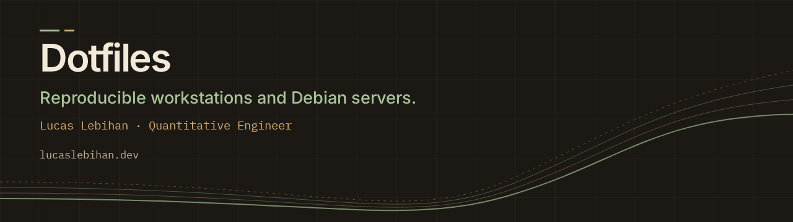

# Dotfiles



[](https://github.com/HtFilia/dotfiles/actions/workflows/ci.yml)
[](LICENSE)

A reproducible development and SSH administration environment for macOS,
Debian/Ubuntu and WSL. Bash orchestrates setup, Python handles independent tool
installation and reports, and Chezmoi manages user
configuration. Workstations and servers share shell, Git, tmux and Neovim
configuration, with explicit profile differences and host-local overrides.

## Design decisions

- **Separate user and system configuration.** `home/` contains Chezmoi source;
  the optional Debian 13 baseline in `system/debian/` owns update policy and
  journal retention. Application deployment and network policy belong elsewhere.
- **Make changes inspectable and recoverable.** Bootstrap and deployment have
  previews; apply takes snapshots; updates preserve the chosen profile.
  Servers receive independent files so pulling Git does not activate edits.
- **Verify downloaded code.** Direct Linux binaries have version/checksum pins;
  shell and editor plugin revisions are recorded. Debian and Homebrew packages
  follow their repositories. [Supply-chain details](docs/SUPPLY-CHAIN.md).
- **Test behavior across platforms.** CI checks Linux and macOS, and installs,
  applies and verifies the server profile twice in a clean Debian 13 container.
  Regressions cover profile selection, drift, local overrides and recovery.

For a code review, start with [profile resolution](scripts/profile.sh),
[deployment and snapshots](scripts/apply-dotfiles.sh),
[verification](scripts/verify.sh), and [behavioral tests](tests/regressions.py).
The [VPS guide](docs/VPS-SERVER.md) documents the system ownership boundary and
rebuild procedure. CI does not test boot, remote connectivity or a full machine
restore.

## Supported environments

| Profile | Platform | Installed environment |
|---|---|---|
| Workstation | macOS with Homebrew and Xcode Command Line Tools | Selected CLI/editor/runtime tools; optional terminal, fonts and container setup |
| Workstation | Debian 12/13 or Ubuntu 24.04/26.04, x86_64 | Selected CLI/editor/runtime tools; optional Docker Engine and fonts |
| Workstation | WSL on a supported Debian/Ubuntu release, x86_64 | Linux development tools; terminal, fonts, VS Code and Docker Desktop belong on Windows |
| Server | Supported Debian/Ubuntu, x86_64 | Shell, CLI navigation, Git/delta/lazygit, tmux, Neovim, Ghostty terminfo; no GUI, fonts or containers; optional language runtimes for selected editor tools |

Linux ARM asset entries are metadata for selected upstream downloads, not a
supported installation profile. Linux Ghostty and VS Code installation are
manual. Homebrew/apt versions follow their repositories; direct Linux downloads
and plugin checkouts are pinned. See [supply chain](docs/SUPPLY-CHAIN.md).

## Install

Configure your GitHub SSH key first, then clone through SSH:

```sh
git clone git@github.com:HtFilia/dotfiles.git ~/.dotfiles
cd ~/.dotfiles
./scripts/bootstrap.sh
```

Run as your regular development/SSH account. Linux package installation needs
sudo. macOS native installs use Homebrew. Finish requested build tools before source
compilation. The workstation picker defaults to 13 practical/prerequisite tools;
use `list` to inspect optional tools and choose fallback channels. See
[selection and generated guides](docs/INSTALLATION.md) and [the tool audit](docs/TOOL-AUDIT.md).

For a server:

```sh
./scripts/bootstrap.sh --profile server --yes
./scripts/verify.sh --profile server
```

For a Debian 13 administrator host with Python/shell editor tools:

```sh
./scripts/bootstrap.sh --profile server --editor-languages python,shell --system-baseline --dry-run
# Review the preview, then repeat without --dry-run.
```
See [the VPS guide](docs/VPS-SERVER.md) for the system ownership boundary.

Useful workstation choices:

```sh
./scripts/bootstrap.sh --tools rg,jq,fd --install-methods native,github --dry-run
./scripts/bootstrap.sh --tools recommended --install-methods github --yes
```

Native Linux installation asks for sudo before logging package commands. Run
bootstrap without sudo; user binaries and dotfiles stay owned by your account.
Output streams to the terminal and report logs. A quiet command prints a heartbeat;
commands time out after five minutes by default (`DOTFILES_INSTALL_TIMEOUT` can
allow longer reviewed source builds). Optional failures continue to the next tool.

Plugins, VS Code extensions, editor setup, shell changes and container service
starts are explicit actions outside the bootstrap. See the single
[installation guide](docs/INSTALLATION.md) for the workflow and failure policy.

## Apply and update

```sh
./scripts/apply-dotfiles.sh --dry-run
./scripts/apply-dotfiles.sh
./scripts/update-dotfiles.sh
# or, after deployment, from any directory:
dotfiles-update
# after a manual git pull:
UPDATE
```

The selected profile and materialization mode are saved under
`~/.local/state/dotfiles`. Workstations use file-level symlinks; servers use
independent files. Choose a mode explicitly with `--materialize file` or
`--materialize symlink`. Apply supports isolated `--destination` and `--source`
paths. Dry runs do not create destination files or persistent state.

The update helper requires a clean checkout and GitHub SSH origin. It snapshots
live contents before a fast-forward pull, then applies the saved profile. Use
`dotfiles-update --after-pull` when the pull was already performed manually.
The installed `UPDATE` command is the explicit post-pull form. The saved source
path, profile and materialization mode make repeated updates safe and
predictable. This matters for symlinks: source edits take effect immediately. See
[deployment and recovery](docs/DEPLOYMENT.md).

## Personal settings

| File | Purpose |
|---|---|
| `~/.gitconfig.local` | Identity, credentials, signing, repository-specific includes |
| `~/.zshrc.settings` | Inputs read before integrations, such as command-override flags |
| `~/.zshrc.local` | Final shell aliases, environment overrides, widgets |
| `~/.tmux.conf.local` | Extra tmux bindings/plugins |
| `~/.ssh/config.local` | SSH hosts and identity paths |

Existing managed files are backed up before apply. Git identity is prompted
when appropriate or supplied through `DOTFILES_GIT_NAME`/`DOTFILES_GIT_EMAIL`.
Existing identity files are preserved.

## Repository map

| Path | Responsibility |
|---|---|
| `Brewfile`, `extensions.txt` | macOS packages and VS Code extensions |
| `home/` | Chezmoi source files, templates, and platform exclusions |
| `scripts/` | Installation, deployment, snapshots, updates, editor setup, verification |
| `system/debian/` | Opt-in Debian 13 APT and journald baseline |
| `scripts/pinned-assets.sh`, `scripts/pinned-plugins.sh` | Authoritative download and plugin pins |
| `assets/terminfo/` | Vendored Ghostty terminfo and upstream license |
| `tests/` | Offline behavioral regressions using temporary homes |
| `.github/workflows/ci.yml` | Linux/macOS checks, Debian 13 install/verify smoke test, actionlint and secret scan |

## Guides

- [Shell startup and customization](docs/SHELL.md)
- [Aliases and helper functions](docs/ALIASES.md)
- [Git behavior](docs/GIT.md)
- [SSH hosts and identities](docs/SSH.md)
- [Ghostty and tmux](docs/TERMINALS.md)
- [Neovim and VS Code](docs/EDITORS.md)
- [Runtimes and project environments](docs/RUNTIMES.md)
- [Tools and their roles](docs/TOOLING.md)
- [Keybindings](docs/KEYBINDINGS.md)
- [Mac Ghostty connecting to a VPS](docs/VPS-GHOSTTY.md)
- [Debian VPS bootstrap and ownership](docs/VPS-SERVER.md)
- [Verification and maintenance](docs/VERIFICATION.md)

## Check the repository

```sh
just check        # syntax, ShellCheck, offline regressions
just dry-run      # isolated deployment preview
just verify       # acceptance checks for this machine
just workflow     # actionlint, when installed
just security     # redacted Git-history secret scan, when installed
```

Checks do not install packages or alter active dotfiles. Full package
installation and language-tool downloads are separate from offline tests.

MIT licensed; vendored terminfo retains its upstream license.

## Optional workstation tools and layouts

```sh
just tools-update        # packages and managed tools, separate from git/config updates
just tools-update --skip-packages
lab                      # nine interactive tool workbooks after deployment
deck                     # shell + live resources + system card
termstyle operator       # control-room layout for active work
```

The default Operator shell layout uses graphite, teal and amber; editor and
diff views use Gruvbox. Styles are selected explicitly and do not add startup
animations or network calls.

The optional catalog offers ouch, zstd, moreutils, ov, hexyl, dua, broot,
Czkawka CLI, xcp, chafa, viu, vivid, pastel, GNU Parallel, tealdeer (`tldr`),
jc and jless. Fastfetch, cmatrix and cava provide explicit visual modes.
See [workbooks](docs/WORKBOOKS.md), [visual styles](docs/VISUALS.md), and
[tool upgrades](docs/UPGRADES.md). Run `dotfiles-style operator` after first deployment
and `tldr --update` once to populate the help cache.
